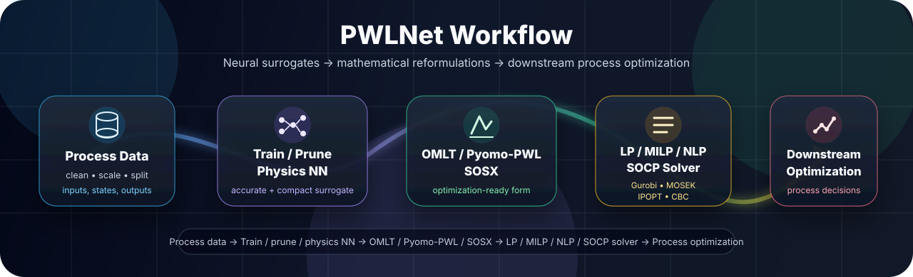
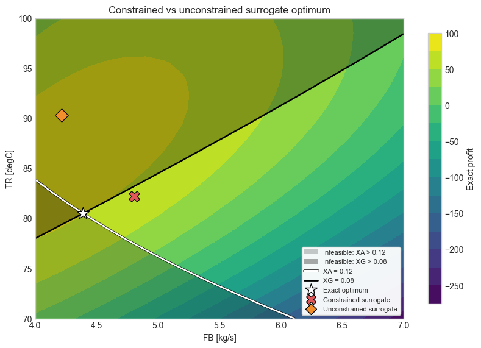
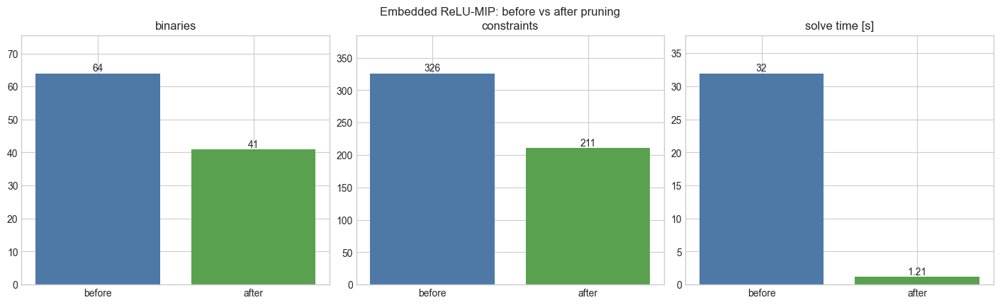
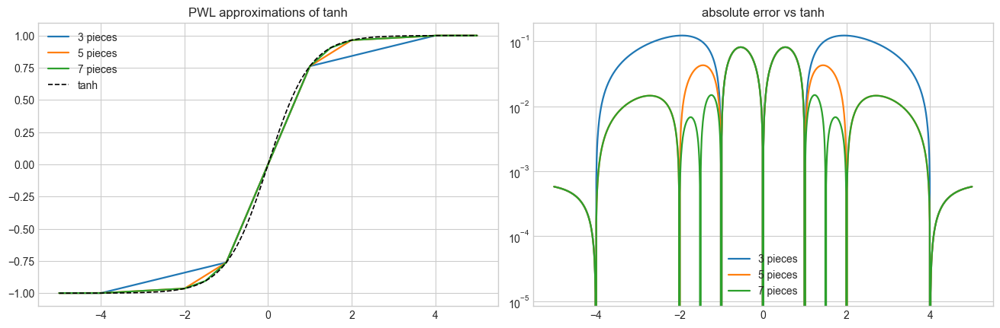
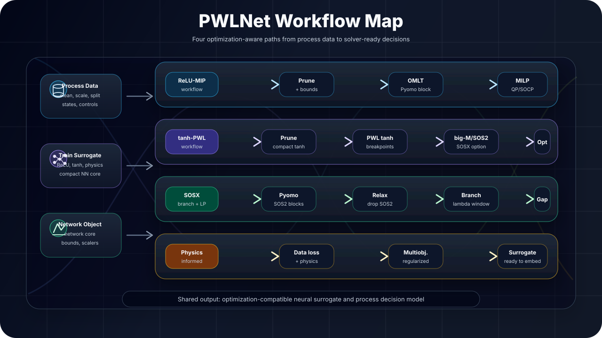
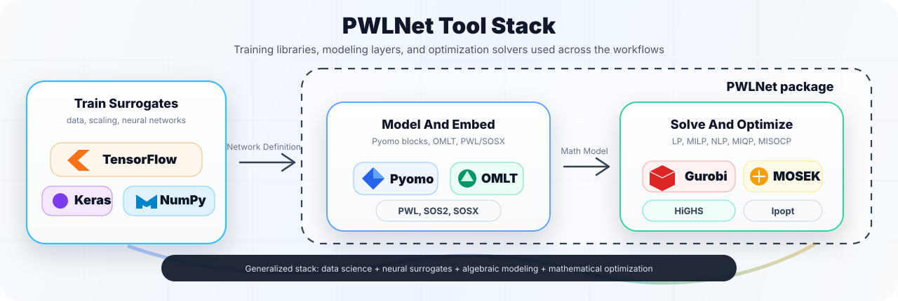

# PWLNet

PWLNet is a Python research library for optimization-aware neural surrogates in
process systems engineering. It trains compact ReLU and tanh models, prunes
them for tractable optimization, reformulates them through OMLT or custom
Pyomo/PWL backends, and validates the resulting decisions on Williams-Otto,
hydroformylation, and Van de Vusse benchmark processes.

<p align="center">
  
</p>

## Why PWLNet?

Most ML pipelines stop at prediction. **PWLNet goes one step further:** it turns neural surrogates into optimization-ready models.

| Problem | PWLNet idea |
|---|---|
| NN is only a predictor | Put the NN inside optimization |
| ReLU MILPs get large | Train and prune compact networks |
| `tanh` is smooth but tricky | Use exact NLP or PWL/SOSX approximations |
| Different models need different solvers | Route to LP / MILP / SOCP / NLP |
| Accuracy is not enough | Validate by downstream decisions |

## What it supports

| Step | Tooling | Goal |
|---|---|---|
| **Data** | cleaning + scaling | usable process data |
| **Train** | Keras ReLU / `tanh`, physics-informed, SOSX-MAE | learn process behavior |
| **Simplify** | pruning + compact models | smaller formulations |
| **Reformulate** | OMLT / Pyomo-PWL / SOSX / exact NLP | solver-ready model |
| **Solve** | HiGHS / Ipopt / Gurobi / MOSEK | LP / MILP / SOCP / NLP |
| **Validate** | Williams-Otto / hydroformylation / Van de Vusse | decision quality |

## What It Shows

<p align="center">
  
</p>

<p align="center">
  <em>Williams-Otto constrained optimization landscape.</em>
</p>

## Optimization-Aware Compression

<p align="center">
  
</p>

<p align="center">
  <em>Before and after network pruning.</em>
</p>

<p align="center">
  
</p>

<p align="center">
  <em>Piecewise-linear approximations of the tanh activation function using 3, 5, and 7 segments.</em>
</p>

PWLNet focuses on neural networks that can be embedded into mathematical optimization models, especially through **ReLU-MIP**, **piecewise-linear tanh approximations**, **Pyomo/OMLT formulations**, and custom **SOSX-style branching** methods.

---

## Main Capabilities

PWLNet supports:

- Training tanh and ReLU neural networks for process surrogate modeling
- Reformulating trained neural networks into Pyomo-compatible optimization models
- ReLU-MIP formulations through OMLT and custom Pyomo formulations
- Exact tanh NLP formulations through OMLT
- Piecewise-linear tanh formulations using big-M, SOS2, and custom SOSX-style branching
- Optimization-aware neural network pruning and compression
- Physics-informed and multiobjective training
- Williams-Otto, hydroformylation, and Van de Vusse process benchmarks
- SOSX-MAE training for bounded, fixed-readout, single-hidden-layer PWL-tanh networks
- Physics-informed ReLU-RNN surrogates unrolled into receding-horizon MPC MILPs

---

## Formulation Backends

| Activation | Formulation | Backend | Problem Type |
|---|---|---|---|
| ReLU | Big-M / partition formulations | OMLT / Pyomo | MILP |
| ReLU | MSE objective extension | Pyomo | MIQP / MISOCP |
| tanh | Exact nonlinear tanh | OMLT / Pyomo | NLP |
| tanh | Piecewise-linear big-M | Pyomo | MILP / MIQP |
| tanh | Piecewise-linear SOS2 | Pyomo | MILP / MIQP / MISOCP |
| tanh | SOSX-style PWL embedding | Custom brancher | Branch-and-LP / branch-and-MILP |
| tanh | SOSX-style MAE training | Custom brancher | Branch-and-LP |
| ReLU RNN | Unrolled recurrent cell, one big-M block per step | OMLT / Pyomo | MILP |

---

## Benchmark Processes

Packaged process modules:

1. `pwlnet.processes.williams_otto`
   - canonical Williams-Otto steady-state equations and parameters
   - SciPy steady-state simulator and dataset generation
   - exact process reference optimum
   - Pyomo optimization models with embedded neural-network surrogates
   - Williams-Otto physics terms for physics-informed training

2. `pwlnet.processes.hydroformylation`
   - dynamic hydroformylation model and BDF integration utilities
   - random input-profile and one-step transition dataset generation
   - delayed-measurement policy simulation
   - PWL-NMPC helper functions for shrinking-horizon and receding-horizon control

3. `pwlnet.processes.van_de_vusse`
   - isothermal Van de Vusse CSTR (`A -> B -> C`, `2A -> D`) with dilution-rate control
   - steady-state simulation, step responses, and transition dataset generation
   - direct-shooting optimal control reference solutions
   - receding-horizon and multiple-shooting NMPC helpers
   - the Sahlodin (2015) nonisothermal variant in `pwlnet.processes.van_de_vusse.sahlodin2015`

These benchmarks are used to evaluate prediction accuracy, optimization
tractability, physics consistency, downstream optimization value, and robustness
under changing process dynamics.

## Notebook Guide

| Notebook | Purpose |
|---|---|
| `01_williams_otto_relu_omlt_baseline.ipynb` | Train a ReLU Williams-Otto surrogate, embed it with OMLT/Pyomo, and compare downstream optimization behavior. |
| `02_williams_otto_tanh_omlt_benchmark.ipynb` | Train a tanh Williams-Otto surrogate and benchmark exact tanh OMLT embedding against the process reference. |
| `03_williams_otto_tanh_pwl_milp.ipynb` | Compare manual PWL-tanh SOS2 and big-M formulations for Williams-Otto optimization. |
| `04_hydroformylation_nmpc_pwl_control.ipynb` | Build and evaluate a hydroformylation transition surrogate for PWL-NMPC control. |
| `05_williams_otto_relu_pruning.ipynb` | Demonstrate optimization-aware ReLU pruning and compare embedded solve size, speed, and decision quality. |
| `06_williams_otto_physics_informed_training.ipynb` | Train Williams-Otto physics-informed surrogates and compare prediction, feasibility, and optimization behavior. |
| `07_hydroformylation_physics_informed_training.ipynb` | Apply physics-informed training to hydroformylation transition surrogates. |
| `08_williams_otto_sosx_branch_and_lp.ipynb` | Demonstrate SOSX branch-and-LP optimization for a Williams-Otto tanh/PWL surrogate. |
| `09_hydroformylation_sosx_shrinking_horizon.ipynb` | Apply the generic `solve_sosx(model, ...)` API to shrinking-horizon hydroformylation NMPC. |
| `10_williams_otto_sosx_input_noise_stress_test.ipynb` | Stress-test Williams-Otto SOSX optimization under input noise and perturbed operating conditions. |
| `11_van_de_vusse_nmpc_pwl_control.ipynb` | Train a horizon-aware Van de Vusse output surrogate and run shrinking-horizon receding control. |
| `12_van_de_vusse_relu_rnn_mpc.ipynb` | Train, prune, and bound-tighten a physics-informed ReLU-RNN, then unroll it into an MPC MILP. |
| `13_boston_housing_surrogate_optimization.ipynb` | Compare tanh, PWL-tanh, and SOSX-MAE surrogates on Boston Housing and optimize over them under constraints. |
| `14_van_de_vusse_nmpc_pwl_control_studies.ipynb` | Extend notebook 11 with global vs. local training studies and plant/model mismatch tests. |

> **Notebook 09 needs a generated dataset.** Its 1230-trajectory hydroformylation training
> set (~50 MB) is not shipped with the package or tracked in git. Build it once from the
> repository root. It takes about 5 min on 10 cores and about 45 min on one, and the output
> is bit-identical to the original data:
>
> ```bash
> python scripts/generate_hydroformylation_datasets.py
> ```

---

## Project Structure

```text
PWLNet/
|-- .github/
|   `-- workflows/
|-- LICENSE
|-- README.md
|-- pyproject.toml
|-- requirements.txt
|-- datasets/
|-- docs/
|-- images/
|-- notebooks/
|-- scripts/          # one-off data generation (not part of the pip package)
`-- src/
    `-- pwlnet/
        |-- api.py
        |-- config.py
        |-- core/
        |-- data/
        |-- training/
        |-- physics/
        |-- objectives/
        |-- pruning/
        |-- formulations/
        |-- branching/
        |-- solvers/
        |-- embedding/
        |-- multiobjective/
        |-- benchmarking/
        |-- recurrent/
        |-- processes/
        |   |-- williams_otto/
        |   |-- hydroformylation/
        |   `-- van_de_vusse/
        `-- utils/
```

---

## Installation

PWLNet requires Python 3.10 or newer. Once published on PyPI, install the base
package or add the extras that match your workflow:

```bash
pip install pwlnet
pip install "pwlnet[highs,training]"
```

Useful extras:

```bash
pip install "pwlnet[highs]"          # Pyomo/OMLT plus open-source HiGHS
pip install "pwlnet[gurobi]"         # Pyomo/OMLT plus optional licensed Gurobi
pip install "pwlnet[mosek]"          # MOSEK Python API for conic/MIQP/MISOCP paths
pip install "pwlnet[training,dev]"   # Keras/TensorFlow, pytest, notebooks
pip install "pwlnet[parallel]"       # Ray support for parallel SOSX training
```

To install from source, including before the first PyPI release:

```bash
git clone https://github.com/SunoySanyal/PWLNet.git
cd PWLNet
pip install -e ".[highs,training,dev]"
```

The same extras are available for editable source installs, for example
`pip install -e ".[mosek]"`.

Gurobi is never required by default. Ipopt is optional for exact tanh NLP
evaluation; set `PWLNET_IPOPT` or add `ipopt` to `PATH` if you want that path.

---

## API Reference

For the complete API and notebook/results reference, see
[`docs/api_reference.md`](https://github.com/SunoySanyal/PWLNet/blob/main/docs/api_reference.md).

The public API is available from the package root and from the underlying
subpackages. The `PWLNet` facade is the easiest entry point; lower-level objects
remain available when you need direct control over training, embedding, solving,
or process simulation.

```python
from pwlnet import (
    PWLNet,
    NetworkDefinition,
    KerasTrainer,
    SosxTrainer,
    PhysicsSpec,
    PhysicsLoss,
    WilliamsOttoPhysics,
    solve_sosx,
    train_test_split,
    regression_metrics,
)
```

### `PWLNet` Facade

`PWLNet` wraps a `NetworkDefinition` and exposes the common workflow methods.

| Method | Purpose |
|---|---|
| `PWLNet.train(X, y, hidden_layers, activation="relu", ...)` | Train a dense Keras ReLU, tanh, or PWL-tanh network and export it to PWLNet's numpy core |
| `PWLNet.train_physics_informed(X, y, hidden_layers, physics=..., physics_weights=..., ...)` | Train with supervised loss plus process physics penalties |
| `PWLNet.train_sosx(X, y, hidden_neurons, ...)` | Globally train a fixed-readout, single-hidden-layer PWL-tanh network under MAE loss |
| `PWLNet.load(path)` / `net.save(path)` | Load or save the JSON network representation |
| `net.predict(X)` | Evaluate the network in original units |
| `net.summary()` | Return a structural `ModelSummary` |
| `net.bounds()` | Run interval bound propagation through the network |
| `net.prune_report()` | Report size estimates and bound-derived pruning opportunities |
| `net.prune(method=..., **kwargs)` | Return a new pruned `PWLNet` |
| `net.compress(...)` | Run the recommended pruning/compression pipeline |
| `net.to_pyomo(formulation=..., backend=..., ...)` | Build an OMLT or Pyomo PWL block for the wrapped network |

### Training

```python
from pwlnet import PWLNet

net = PWLNet.train(
    X_train,
    y_train,
    hidden_layers=[16, 16],
    activation="tanh",
    loss="mse",
    optimizer="adam",
    learning_rate=1e-3,
    epochs=500,
    batch_size=32,
    validation_data=(X_val, y_val),
    scaling_method="standard",
    random_seed=7,
    early_stopping_patience=30,
)

pred = net.predict(X_test)
net.save("models/williams_otto_tanh.json")
```

`PWLNet.train` delegates to `KerasTrainer`. The returned network carries fitted
input/output scalers and input bounds in original units, so `predict`,
`to_pyomo`, and `solve_sosx` use the same physical-unit interface.

#### Training Through The PWL (`activation="pwl_tanh"`)

A tanh network that is embedded as a piecewise-linear block is read by the
solver through a function it was never fitted to, and that mismatch compounds
over a chained or receding horizon. `activation="pwl_tanh"` trains through the
PWL tanh itself -- it is a sum of ReLUs, so it backpropagates normally -- and
the embedding then reproduces the trained model to float round-off.

```python
net = PWLNet.train(
    X_train,
    y_train,
    hidden_layers=[16, 16],
    activation="pwl_tanh",
    breakpoints=5,  # must match the breakpoints used to embed
    epochs=500,
    validation_data=(X_val, y_val),
)
model, block = net.to_pyomo(
    formulation="tanh_pwl_sos2", backend="pyomo_pwl", breakpoints=5
)
```

The hidden layers are exported labelled `"tanh"`, which is what makes the PWL
embedding build its block for them. Consequently `net.predict(X)` reads the
network with *exact* tanh and is **not** what the solver sees; for that
reading use
`evaluate_tanh_pwl_network(net.network, X, breakpoints=5)`.

### Core Network Object

`NetworkDefinition` is the framework-independent model object behind the facade.
It stores ordered `DenseLayer` objects, optional `OffsetScaler` instances, and
optional original-unit `input_bounds`.

| Member | Purpose |
|---|---|
| `n_inputs`, `n_outputs`, `n_layers` | Basic model dimensions |
| `hidden_layer_sizes`, `activations` | Architecture metadata |
| `forward_scaled(X_scaled)` | Evaluate the raw scaled-space network |
| `predict(X)` | Evaluate with input scaling and inverse output scaling |
| `scaled_input_bounds()` | Convert original-unit input bounds into scaled bounds |
| `to_dict()` / `from_dict()` | JSON-compatible representation |
| `save(path)` / `load(path)` | Exact float round-trip serialization |

### Pruning And Compression

```python
report = net.prune_report()

pruned, outcome = net.prune(
    method="neuron_magnitude",
    fraction=0.30,
    fine_tune=True,
    X=X_train,
    y=y_train,
    validation_data=(X_val, y_val),
    return_outcome=True,
)

compressed = net.compress(
    X=X_train,
    y=y_train,
    magnitude_fraction=0.20,
    neuron_fraction=0.25,
    fine_tune=True,
    epochs=100,
)
```

Supported pruning names are `dead_relu`, `always_active`, `always_active_relu`,
`relus`, `relu`, `saturated_tanh`, `weight_magnitude`, `magnitude`, `neuron`,
`neuron_magnitude`, `group_lasso`, and `obd`. Pruning methods never mutate the
source network; they return a new network wrapped in a new `PWLNet` facade.

### Physics-Informed Training

Process physics can be passed as a `PhysicsLoss` object, a registered physics
name, or a name-based `PhysicsSpec`.

```python
from pwlnet import PWLNet, PhysicsSpec

physics = (
    PhysicsSpec(
        input_names=["FB", "TR"],
        output_names=["XA", "XB", "XE", "XP", "XG"],
        name="williams_otto_constraints",
    )
    .closure(["XA", "XB", "XE", "XP", "XG"], total=1.0)
    .upper_bounds({"XA": 0.12, "XG": 0.08}, name="quality_bounds")
)

pi_net = PWLNet.train_physics_informed(
    X_train,
    y_train,
    hidden_layers=[16, 16],
    activation="tanh",
    physics=physics,
    physics_weights={"closure": 0.10, "quality_bounds": 0.05},
    epochs=800,
    validation_data=(X_val, y_val),
)
```

The Williams-Otto process module also exports `WilliamsOttoPhysics`, which can
be passed directly as the `physics` argument.

### SOSX-MAE Training

`PWLNet.train_sosx` and `SosxTrainer` globally train the input layer of a
bounded, single-hidden-layer PWL-tanh network under MAE loss while keeping the
linear readout fixed. With the readout fixed, each branch-and-bound node is a
linear program.

```python
sosx_net = PWLNet.train_sosx(
    X_train,
    y_train,
    hidden_neurons=8,
    breakpoints=7,
    readout="keras",
    solver="appsi_highs",
    solver_options={"persistent": True},
    node_selection="best_bound",
    branching_rule="most_violated",
    max_nodes=5000,
    relative_gap=1e-3,
    time_limit=300,
    random_seed=7,
    keras_options={"epochs": 300, "verbose": 0},
)

print(sosx_net.trainer.training_mae_, sosx_net.trainer.n_nodes_)
```

Readout options are `"keras"`, `"random"`, `"least_squares"`, or an explicit
matrix with shape `(hidden_neurons, n_outputs)`. Reuse previous solutions by
passing `initial_network=...`, `W2=...`, or `incumbent=...` to the fit call.

### Pyomo And OMLT Export

```python
model, block = net.to_pyomo(
    backend="omlt",
    formulation="relu_bigm",
    block_name="surrogate",
)
```

```python
model, block = net.to_pyomo(
    backend="pyomo_pwl",
    formulation="tanh_pwl_sos2",
    breakpoints=7,
)
```

Supported facade export combinations:

| Backend | Formulation | Problem class |
|---|---|---|
| `omlt` | `relu_bigm` | MILP for ReLU networks |
| `omlt` | `tanh_exact` | Smooth NLP for tanh networks |
| `pyomo_pwl` | `tanh_pwl_sos2` | PWL tanh SOS2 formulation |
| `pyomo_pwl` | `tanh_pwl_bigm` | PWL tanh big-M formulation |

Lower-level builders are available when you need to attach multiple blocks or
control the surrounding model yourself:

```python
from pwlnet.formulations.omlt import build_omlt_block, evaluate_block
from pwlnet.formulations.pyomo_pwl import (
    build_tanh_pwl_sos2_block,
    build_tanh_pwl_bigm_block,
    build_tanh_pwl_data,
)
```

### Process Modules

```python
from pwlnet.processes.williams_otto import (
    WilliamsOttoParameters,
    WilliamsOttoPhysics,
    generate_dataset,
    simulate_points,
    solve_steady_state,
    build_exact_model,
    build_surrogate_optimization_model,
    solve_surrogate_optimization_model,
)

from pwlnet.processes.hydroformylation import (
    HydroformylationParameters,
    make_transition_dataset,
    random_control_profiles,
    simulate_policy,
    run_receding_horizon_nmpc,
    solve_receding_move,
    tighten_network_bounds,
)

from pwlnet.processes.van_de_vusse import (
    VanDeVusseParameters,
    make_transition_dataset,
    simulate_policy,
    solve_direct_shooting_optimal_control,
    run_receding_horizon_nmpc,
)
```

### Recurrent ReLU-RNN Surrogates

A vanilla Elman cell with a ReLU activation is piecewise linear, so a trained
recurrent model can be pruned, bound-tightened across the horizon, and unrolled
into an MPC MILP with one `relu_bigm` block per step.

```python
from pwlnet import RNNTrainer
from pwlnet.recurrent import (
    RecurrentCell,
    propagate_recurrent_bounds,
    build_unrolled_mpc_model,
    solve_unrolled_mpc,
)
```

Notebook 12 walks through the full workflow on the Van de Vusse CSTR.

---

## Solver Backends

PWLNet uses Pyomo solver factory names. HiGHS via `appsi_highs` is the default
open-source MILP/LP solver for ReLU big-M and SOSX workflows. Gurobi interfaces
such as `gurobi`, `gurobi_direct`, `gurobi_persistent`, and `appsi_gurobi` are
optional and require a local Gurobi installation/license. Ipopt is optional for
exact tanh NLP evaluation.

```python
from pwlnet.solvers import get_pyomo_solver

solver = get_pyomo_solver("appsi_highs", options={"time_limit": 60})
gurobi = get_pyomo_solver("gurobi")  # optional/licensed
```

The SOSX API is exported from the solver package and the package root:

```python
from pwlnet import solve_sosx
# equivalent: from pwlnet.solvers import solve_sosx
```

`solve_sosx` accepts either an already-built Pyomo model or a trained
`NetworkDefinition`. A network input invokes the built-in Williams-Otto
convenience workflow used by notebook 08:

```python
result = solve_sosx(
    WO_model,
    solver="appsi_highs",
    solver_options={"persistent": True},
    profit_formulation="mccormick",
    breakpoints=5,
    node_selection="best_bound",
    branching_rule="first",
    max_nodes=2000,
    optimality_tolerance=1e-7,
    violation_tolerance=1e-6,
    time_limit=120,
    relative_gap=1e-3,
)
```

For other processes, users build the Pyomo variables, constraints, and
objective themselves and pass that model to the same function:

```python
import pyomo.environ as pyo

from pwlnet import solve_sosx
from pwlnet.formulations.pyomo_pwl import build_tanh_pwl_sos2_block

model = pyo.ConcreteModel()
model.temperature = pyo.Var(bounds=(300.0, 400.0))
model.feed = pyo.Var(bounds=(0.0, 10.0))

surrogate = build_tanh_pwl_sos2_block(
    model,
    process_model,  # trained NetworkDefinition with input bounds
    block_name="surrogate",
    breakpoints=5,
)
model.connect_temperature = pyo.Constraint(
    expr=surrogate.inputs[0] == model.temperature
)
model.connect_feed = pyo.Constraint(expr=surrogate.inputs[1] == model.feed)
model.quality_limit = pyo.Constraint(expr=surrogate.outputs[1] <= 0.15)
model.objective = pyo.Objective(
    expr=100.0 * surrogate.outputs[0] - 2.0 * model.feed,
    sense=pyo.maximize,
)

result = solve_sosx(
    model,
    blocks=[surrogate],  # optional; blocks can be auto-discovered
    sense="maximize",
    track={
        "temperature": model.temperature,
        "feed": model.feed,
        "product": surrogate.outputs[0],
    },
    solver="appsi_highs",
    solver_options={"persistent": True},
)
```

The trained network weights and biases remain fixed during this solve. SOSX
branches on the PWL convex-combination variables while optimizing the process
variables defined by the user.

For repeated solves such as NMPC, pass the previous result back as a candidate
incumbent:

```python
next_result = solve_sosx(
    updated_model,
    sense="minimize",
    solver_options={
        "persistent": True,
        "incumbent": previous_result,
    },
)
```

The previous objective is not trusted. PWLNet derives its adjacent lambda
windows, solves that restricted node on the updated model, and seeds the new
tree only when the candidate remains feasible and SOS2-valid.

Important `solve_sosx` controls:

| Option | Default | Purpose |
|---|---:|---|
| `solver` | `None` (`appsi_highs`) | Node LP/MILP solver name or solver object |
| `solver_options` | `None` | Per-node solver options; `{"persistent": True}` enables incremental APPSI solves |
| `solver_options["incumbent"]` | `None` | Previous `SosxResult`; revalidate its SOS2 windows and seed pruning |
| `node_selection` | `"best_bound"` | Open-node order; alternatively `"depth_first"` |
| `branching_rule` | `"first"` | Violated SOS set selection; alternatively `"most_violated"` |
| `max_nodes` | `2000` | Maximum solved branch nodes |
| `optimality_tolerance` | `1e-7` | Incumbent-update and bound-fathoming tolerance |
| `violation_tolerance` | `1e-6` | Lambda threshold used by SOS2 violation detection |
| `time_limit` | `None` | Total brancher wall-clock limit, checked between nodes |
| `absolute_gap` | `None` | Stop at the requested incumbent-to-bound absolute gap |
| `relative_gap` | `None` | Stop at the requested incumbent-to-bound relative gap |

Use a solver-specific time limit inside `solver_options` when one node solve
must also be bounded. The top-level `time_limit` controls the complete SOSX
search.

---

## Example Usage

```python
from pwlnet import PWLNet

net = PWLNet.train(
    X_train,
    y_train,
    activation="tanh",
    hidden_layers=[10],
    loss="mse",
)

net = net.prune(
    method="neuron_magnitude",
    fraction=0.25,
    fine_tune=True,
    X=X_train,
    y=y_train,
)

model, block = net.to_pyomo(
    backend="pyomo_pwl",
    formulation="tanh_pwl_sos2",
    breakpoints=[-4, -2, -1, 1, 2, 4],
)
```

Physics-informed training uses the same facade with a modular physics provider:

```python
from pwlnet import PWLNet
from pwlnet.processes.williams_otto import WilliamsOttoPhysics

pi_net = PWLNet.train_physics_informed(
    X_train,
    y_train,
    activation="tanh",
    hidden_layers=[16, 16],
    physics=WilliamsOttoPhysics(),
    physics_weights={"closure": 0.10, "bounds": 0.05},
)
```

---

## Workflows

<p align="center">
  
</p>

The workflow map combines the ReLU-MIP, tanh-PWL, SOSX branch-and-LP, and
physics-informed training paths into one solver-oriented view.

---

## Physics-Informed and Multiobjective Training

PWLNet has a modular physics-informed trainer. Process-specific terms are
implemented by subclasses of `PhysicsLoss` and can be passed directly to
`PWLNet.train_physics_informed` or registered by name with `register_physics`.
The process-owned `WilliamsOttoPhysics` module contributes:

- Mass-fraction closure loss
- Operating-bound penalties for Williams-Otto `XA` and `XG`

Balance residuals for Williams-Otto are available through
`pwlnet.processes.williams_otto.residuals` and can be used as diagnostics or as
inputs to custom physics modules.

A general multiobjective training problem may be written as:

```text
minimize:
    data loss
  + physics residual loss
  + regularization loss
  + pruning/compression loss
```

---

## Related Tools

<p align="center">
  
</p>

PWLNet is intended to complement existing optimization and machine learning tools such as:

- Pyomo
- OMLT
- TensorFlow/Keras
- PyTorch
- HiGHS
- SCIP
- Gurobi
- MOSEK

---

## Dependencies

The base package installs these numerical and optimization modeling dependencies:

```
numpy
scipy
pandas
pyomo
omlt
```

Training, solver, parallel processing, and development dependencies are provided as extras:

| Extra | Dependencies |
|---|---|
| `optimization` or `highs` | highspy |
| `gurobi` | gurobipy |
| `mosek` | mosek |
| `training` | tensorflow, keras |
| `parallel` | ray>=2.9, highspy |
| `dev` | matplotlib, pytest, nbformat, nbconvert, jupyter, ipykernel |

MOSEK is optional; install `pwlnet[mosek]` for the MSE-based PWL training
functionality or other paths that use MOSEK. These routines require a valid
MOSEK license at `~/mosek/mosek.lic` or pointed to by the
`MOSEKLM_LICENSE_FILE` environment variable.

Gurobi is not required for the main package. Some notebook examples can use
Gurobi when available, but the repository is designed to run without it.

## Citing this work

If you use this repository in your work, please cite the forthcoming arXiv preprint and the relevant papers associated with the methods implemented in the library. These publications provide further details on the underlying algorithms, formulations, and related work included in the repository. You can find the relevant papers used in this library in the references section below.

> Sanyal, S., Demir, C., Türkay, M. Aydın, E. (2026). *PWLNet: Piecewise-linear neural-network surrogates for optimization*. arXiv preprint, arXiv.XXXXX. Forthcoming.


## References

### ReLU-MIP, neural-network embedding, and pruning

1. Grimstad, B., & Andersson, H. (2019). ReLU networks as surrogate models in mixed-integer linear programs. *Computers & Chemical Engineering, 131*, 106580. doi: 10.1016/j.compchemeng.2019.106580

2. Anderson, R., Huchette, J., Ma, W., Tjandraatmadja, C., & Vielma, J. P. (2020). Strong mixed-integer programming formulations for trained neural networks. *Mathematical Programming*. arXiv:1811.01988.

3. Tsay, C., Kronqvist, J., Thebelt, A., & Misener, R. (2021). Partition-based formulations for mixed-integer optimization of trained ReLU neural networks. *Advances in Neural Information Processing Systems*. arXiv:2102.04373.

4. Lueg, L., Grimstad, B., Mitsos, A., & Schweidtmann, A. M. (2021). *reluMIP: Open Source Tool for MILP Optimization of ReLU Neural Networks*. Zenodo. doi: 10.5281/zenodo.5601907

5. LeCun, Y., Denker, J. S., & Solla, S. A. (1989). Optimal Brain Damage. In *Advances in Neural Information Processing Systems 2*, 598-605.

6. Liu, C., Zhang, Z., & Wang, D. (2014). Pruning deep neural networks by optimal brain damage. In *Proceedings of INTERSPEECH 2014*, 1092-1095. doi: 10.21437/Interspeech.2014-281

### Piecewise-linear and SOSX neural-network training

7. Koksal, E. S., & Aydin, E. (2023). Physics informed piecewise linear neural networks for process optimization. *Computers & Chemical Engineering, 174*, 108244. doi: 10.1016/j.compchemeng.2023.108244

8. Koksal, E. S., Turkay, M., & Aydin, E. (2026). A computationally efficient piecewise linear training algorithm for neural networks utilizing continuous special ordered sets. *Chemical Engineering Research and Design, 229*, 266-277. doi: 10.1016/j.cherd.2026.03.047

9. Keha, A. B., de Farias, I. R., & Nemhauser, G. L. (2004). Models for representing piecewise linear cost functions. *Operations Research Letters, 32*(1), 44-48. doi: 10.1016/S0167-6377(03)00059-2

10. Keha, A. B., de Farias, I. R., & Nemhauser, G. L. (2006). A branch-and-cut algorithm without binary variables for nonconvex piecewise linear optimization. *Operations Research, 54*(5), 847-858. doi: 10.1287/opre.1060.0277

11. Schweidtmann, A. M., & Mitsos, A. (2019). Deterministic global optimization with artificial neural networks embedded. *Journal of Optimization Theory and Applications, 180*(3), 925-948. doi: 10.1007/s10957-018-1396-0

12. Sildir, H., & Aydin, E. (2022). A mixed-integer linear programming based training and feature selection method for artificial neural networks using piece-wise linear approximations. *Chemical Engineering Science, 249*, 117273. doi: 10.1016/j.ces.2021.117273

### Dynamic optimization and hydroformylation case study

13. Aydin, E., Bonvin, D., & Sundmacher, K. (2017). Dynamic optimization of constrained semi-batch processes using Pontryagin's minimum principle - An effective quasi-Newton approach. *Computers & Chemical Engineering, 99*, 135-144. doi: 10.1016/j.compchemeng.2017.01.019

14. Aydin, E., Bonvin, D., & Sundmacher, K. (2018). NMPC using Pontryagin's minimum principle - Application to a two-phase semi-batch hydroformylation reactor under uncertainty. *Computers & Chemical Engineering, 108*, 47-56. doi: 10.1016/j.compchemeng.2017.08.010

15. Kiedorf, G., Hoang, D. M., Muller, A., Jorke, A., Markert, J., Arellano-Garcia, H., Seidel-Morgenstern, A., & Hamel, C. (2014). Kinetics of 1-dodecene hydroformylation in a thermomorphic solvent system using a rhodium-biphephos catalyst. *Chemical Engineering Science, 115*, 31-48. doi: 10.1016/j.ces.2013.06.027

16. Hentschel, B., Kiedorf, G., Gerlach, M., Hamel, C., Seidel-Morgenstern, A., Freund, H., & Sundmacher, K. (2015). Model-based identification and experimental validation of the optimal reaction route for the hydroformylation of 1-dodecene. *Industrial & Engineering Chemistry Research, 54*, 1755-1765. doi: 10.1021/ie504388t

### Williams-Otto benchmark

17. Williams, T. J., & Otto, R. E. (1960). A generalized chemical processing model for the investigation of computer control. *Transactions of the American Institute of Electrical Engineers, Part I: Communication and Electronics, 79*(5), 458-473.

18. Schmid, J., Teichert, K., Chioua, M., Schindler, T., & Bortz, M. (2020). Simulation and optimal control of the Williams-Otto process using Pyomo. arXiv:2004.07614.

### Software

19. Bynum, M. L., Hackebeil, G. A., Hart, W. E., Laird, C. D., Nicholson, B. L., Siirola, J. D., Watson, J.-P., & Woodruff, D. L. (2021). *Pyomo - Optimization Modeling in Python* (3rd ed.). Springer.

20. Hart, W. E., Watson, J.-P., & Woodruff, D. L. (2011). Pyomo: Modeling and solving mathematical programs in Python. *Mathematical Programming Computation, 3*(3), 219-260.

21. Ceccon, F., Jalving, J., Haddad, J., Thebelt, A., Tsay, C., Laird, C. D., & Misener, R. (2022). OMLT: Optimization & Machine Learning Toolkit. *Journal of Machine Learning Research, 23*(349), 1-8.

22. Huangfu, Q., & Hall, J. A. J. (2018). Parallelizing the dual revised simplex method. *Mathematical Programming Computation, 10*(1), 119-142. doi: 10.1007/s12532-017-0130-5

23. Abadi, M., Barham, P., Chen, J., Chen, Z., Davis, A., Dean, J., Devin, M., Ghemawat, S., Irving, G., Isard, M., et al. (2016). TensorFlow: A system for large-scale machine learning. In *Proceedings of the 12th USENIX Symposium on Operating Systems Design and Implementation*, 265-283.

24. Chollet, F., et al. (2015). Keras.

25. Pedregosa, F., Varoquaux, G., Gramfort, A., Michel, V., Thirion, B., Grisel, O., Blondel, M., Prettenhofer, P., Weiss, R., Dubourg, V., VanderPlas, J., Passos, A., Cournapeau, D., Brucher, M., Perrot, M., & Duchesnay, E. (2011). Scikit-learn: Machine learning in Python. *Journal of Machine Learning Research, 12*, 2825-2830.

26. Harris, C. R., Millman, K. J., van der Walt, S. J., Gommers, R., Virtanen, P., Cournapeau, D., Wieser, E., Taylor, J., Berg, S., Smith, N. J., et al. (2020). Array programming with NumPy. *Nature, 585*, 357-362. doi: 10.1038/s41586-020-2649-2

27. Virtanen, P., Gommers, R., Oliphant, T. E., Haberland, M., Reddy, T., Cournapeau, D., Burovski, E., Peterson, P., Weckesser, W., Bright, J., et al. (2020). SciPy 1.0: Fundamental algorithms for scientific computing in Python. *Nature Methods, 17*, 261-272. doi: 10.1038/s41592-019-0686-2

28. McKinney, W. (2010). Data structures for statistical computing in Python. In *Proceedings of the 9th Python in Science Conference*, 56-61.

29. Hunter, J. D. (2007). Matplotlib: A 2D graphics environment. *Computing in Science & Engineering, 9*(3), 90-95. doi: 10.1109/MCSE.2007.55

30. Gurobi Optimization, LLC. (2026). *Gurobi Optimizer Reference Manual*. Optional dependency.

31. MOSEK ApS. (2026). *MOSEK Optimizer API for Python*. Optional dependency.

---

## License

This project is licensed under the **Apache License 2.0**.

See the [LICENSE](https://github.com/SunoySanyal/PWLNet/blob/main/LICENSE) file for details.
